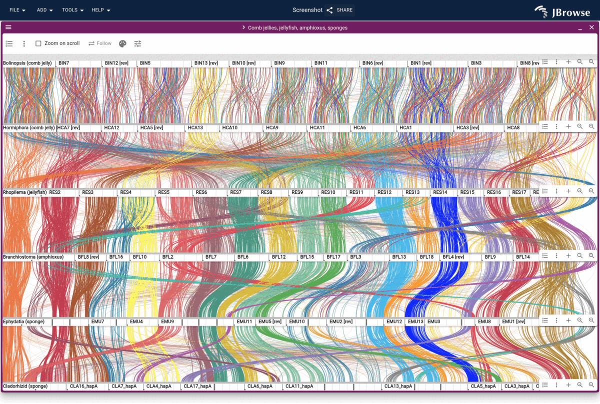

# orthologs2jbrowse

Turns ortholog calls into the tables a [JBrowse 2](https://jbrowse.org) synteny
track loads: a `.blocks` or `.anchors` table of gene ids, and a BED placing each
gene, so every ortholog draws as a ribbon between genomes.



## Install

```bash
pip install git+https://github.com/cmdcolin/orthologs2jbrowse
```

Python 3.9 or later, no other dependencies; `kaks` also needs Biopython
(`pip install "orthologs2jbrowse[kaks] @ git+https://github.com/cmdcolin/orthologs2jbrowse"`).

## Commands

Each command takes the file its tool writes. `orthologs2jbrowse <command> -h`
lists its arguments.

- `orthofinder`: OrthoFinder's `Orthogroups.tsv`
  ([tutorial](https://jbrowse.org/jb2/docs/tutorials/orthofinder_synteny/))
- `odp`: an odp `.rbh` table
  ([tutorial](https://jbrowse.org/jb2/docs/tutorials/odp_linkage_groups_synteny/))
- `mcscanx`: an MCScanX `.collinearity` and its `.gff`
  ([tutorial](https://jbrowse.org/jb2/docs/tutorials/mcscan_synteny_grape_peach/))
- `compara`: an Ensembl Compara homology TSV, keeping its identity and rates
  ([guide](https://jbrowse.org/jb2/docs/config_guides/synteny_track/))
- `symbols`: GFF3 files, joined on gene symbol, with no alignment
  ([tutorial](https://jbrowse.org/jb2/docs/tutorials/primate_orthologs_synteny/))
- `kaks`: dN and dS for each gene pair, to color a table by selection
  ([tutorial](https://jbrowse.org/jb2/docs/tutorials/selection_pressure/))

For example:

```bash
orthologs2jbrowse orthofinder Orthogroups.tsv -o genomes.blocks \
  --bed rice=rice.bed --bed maize=maize.bed
```
